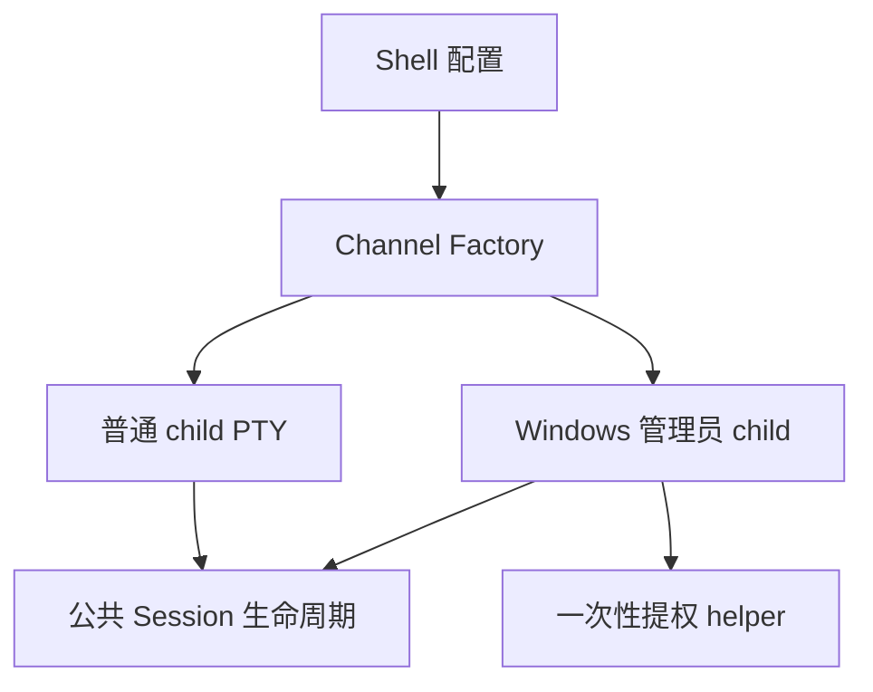

# Local Shell 设计

## 目标

Local Shell 让本机命令行与远端/设备 Session 使用同一套终端工作区，同时保持本地进程、工作目录和权限语义清晰。

## 当前方案

Shell 预设发现属于配置辅助能力，只在进入 Local Shell 配置页时按需执行。自动发现结果以实际探测到的组件名称为主体；仅在有助于区分来源时保留必要分类，例如 WSL 发行版显示为 `WSL · <注册发行版名称>`，不再生成编号或泛化别名。Windows 上的 WSL 发行版探测运行在后台 blocking worker，并设置有限等待时间；平台命令异常或 WSL 服务不可用时只跳过对应预设，不能阻塞配置页面或 Session 核心。

Local Shell 通过平台原生 PTY 创建终端：

- Windows 使用 ConPTY；
- Linux/macOS 使用 Unix PTY。

一个保存配置可以作为父 Session 创建多个独立本地终端。公共核心负责 child lifecycle，Local Shell 工厂负责解析 shell、参数、工作目录并创建对应进程。

Windows 的“以管理员身份新建”只提升某一个 child terminal。主 TauTerm 进程保持普通权限，通过一次性受控 helper/本地 IPC 建立管理员 ConPTY；拒绝 UAC 不产生 child。WSL 仍按 Linux 环境语义运行，不使用该 Windows 原生提权路径。

## 关键数据流

## 设计边界

- 主应用不因管理员 Shell 整体提权。
- 管理员属性属于单个运行时 child，不写回父配置。
- 每个 child 是独立进程/PTY，不共享 shell 进程状态。
- Local Shell 配置包含“环境变量”字段（KEY/VALUE 行），在表单中位于启动参数之前：后端校验名称（A-Z/a-z/0-9/_）、数量与长度上限后通过 `CommandBuilder` 注入 shell 进程环境，不经过 shell 语法解析；连接前忽略空行，非法/重名名称在表单内联提示，切到 WSL preset 时表单清空该区块；WSL shell 明确拒绝该字段（子系统自己管理环境），管理员 shell 通过 helper 配置一并传递，后端可识别的失败文案由插件层本地化。
- Windows 普通本地 Shell 不经过任何额外的 helper/launcher 进程：`LocalShellDriver` 在创建伪控制台前先锁定随包分发的 ConPTY 引擎（`conpty.dll` + `OpenConsole.exe`，Microsoft Windows Console ConPTY 1.25.260930003，MIT，见 `THIRD_PARTY_LICENSES.md` 与 `src-tauri/vendor/conpty/`），然后把请求的 shell 直接作为 PTY 子进程启动。管理员 Shell 仍只多一次提权 helper，helper 内同样由驱动直接启动 shell，不改变引擎选择。选择该引擎的原因：系统内置 conhost 引擎只有在控制台输入模式已带 `ENABLE_VIRTUAL_TERMINAL_INPUT` 时才转发子进程写入的鼠标上报模式（`DECSET 1000/1002/1003/1006`），而 VT-first 全屏程序（pi 等 Node TUI）在进入 raw mode 之前就写这些序列，导致外层终端永远收不到鼠标；native console 程序（Codex/crossterm）走 `SetConsoleMode` 另一条路径，所以一直正常。随包引擎是 Windows Terminal 使用的实现，对两类程序都按字节转发，因此终端能力由终端引擎负责，不需要按程序白名单或轮询控制台模式。
- 引擎启动握手由驱动在本地完成：引擎初始化伪控制台时会查询光标位置（`ESC[6n`）和设备属性（`ESC[c`），驱动在启动窗口内本地应答并从可见输出中移除这些查询，避免 shell 启动依赖 WebView/xterm 是否就绪，也避免 xterm 的第二次应答变成 shell 的杂散输入。
- 该引擎**不是字节直通**：它维护自己的控制台屏幕模型，跨行时用「裸 LF + 相对光标移动（`CUB n`）」重绘行首，所以行首列只有在裸 LF 不被改写时才成立。因此宿主终端**不得**为 PTY 会话开启 xterm 的 `convertEol`：它把每个 LF 改写成 CR+LF，注入的 CR 会把光标钳到第 0 列，随后的相对移动变成空操作，整行贴到最左侧（半块像素画 logo 会因此碎成错位方块）。`convertEol` 只保留给 Serial / RTT 等非 PTY 原始字节流；该契约由 `npm run check:terminal-screen` 锁定。
- Local Shell 使用终端搜索、尺寸与日志能力，但不启用远端传输或全局 SendBar。
- shell 发现只提供可解释的候选；自定义 executable、参数和工作目录必须保持独立字段，避免命令字符串拼接。
- WSL 端点发现与工作目录探针都经 `kernel::process::hidden_command` 启动。Windows 子进程可见性边界（含 UAC 提权 helper 的 `SW_HIDE` 例外）由 [PLATFORM_SECURITY.md](PLATFORM_SECURITY.md) 拥有，由 `npm run check:windows-spawn` 锁定，本文不复述其机制。
- `LocalShellConfig::resolve()` 是**纯计算**：只做参数校验、executable 解析、工作目录/argv 拼装，不启动任何进程。它同时服务于“生成默认会话名”，因此任何探测放进 `resolve()` 都会变成“改一个配置项就跑一次发行版”。WSL 工作目录的存在性由 `connect_with_mode` 在建立 PTY 前用一次隐藏探针确认，并放在 blocking worker 上执行。
- 该探针不能被删除：`wsl.exe --cd <dir>` 对**不存在**的目录不会失败——实测它只在 stderr 报一行 `chdir(...) failed`，然后在 `/` 里启动进程并返回 0。因此探针不再依赖 `--cd` 的退出码，而是在同一个发行版/同一用户下直接 `cd` 到目标目录（与真实会话同一个 chdir）；成功即通过，失败返回专用退出码（目录不可用）并给出明确错误。`~`/`~/…` 在探针脚本内用 `$HOME` 展开，路径以位置参数传入，不参与 shell 语法拼接。探针有界（15s，进程等待与管道收集都受限）并在超时后 kill。
- Local Shell 启动的 shell 进程固定获得 `TERM=xterm-256color` 与 `COLORTERM=truecolor`；配置的环境变量行在默认值之后应用，因此显式 `TERM` 行可覆盖它。子进程看到的 terminal type 决定 `clear` 等 terminfo 行为，宿主不改写其输出。
- Local Shell 的 PTY 以宿主共享初始几何（`crate::session::DEFAULT_TERMINAL_COLUMNS/ROWS`）=120×30 建立，不依赖 `portable-pty` 的默认 24×80。终端几何的所有权、前端首次 `fit()` 的下发时机与防抖策略由 [UI_FOUNDATION.md](UI_FOUNDATION.md) 拥有。

## 代码锚点

- `src/plugins/local-shell/`
- `src-tauri/src/plugins/local_shell/`
- `src-tauri/src/kernel/session_store.rs`
- Windows helper 与启动边界位于 `src-tauri/src/`

## 何时更新本文

修改 PTY 后端、shell 解析/发现、父子会话、管理员 child、IPC/权限边界时，必须同步更新本文。
